# Lucky Mart Procurement Portal

[](https://github.com/LuckySiagian/lucky-mart-procurement/actions/workflows/ci.yml)

An internal portal for restocking my family's grocery store. Staff create purchase orders to
suppliers, the owner approves them, and when the goods arrive the stock is added to
[Lucky Mart](https://github.com/LuckySiagian/lucky-mart), the store's ordering platform.

> **Status:** backend, frontend, CI and monitoring work end to end locally. The AWS
> infrastructure is written with the CDK and tested in CI, but **not deployed** yet
> ([infra/README.md](infra/README.md)).

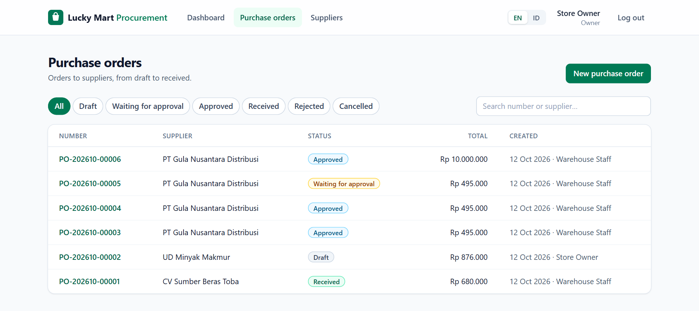

## How it works

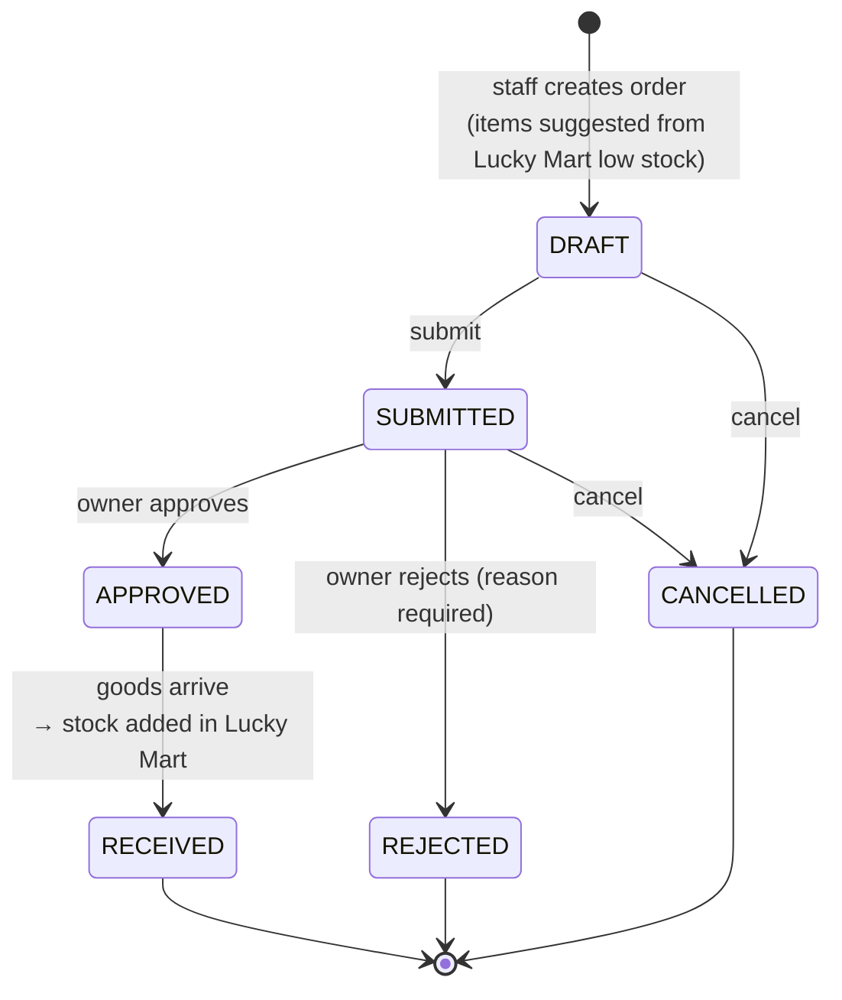

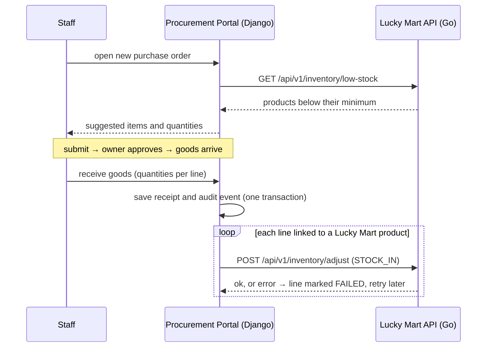

- **Roles:** staff prepare and receive orders; only the owner approves, and never their own order.
- **Audit trail:** every status change records who did it and when.
- **Safe stock sync:** a receipt is saved even if Lucky Mart is down. Failed lines can be retried,
  and lines already synced are never sent twice.
- **English and Indonesian:** the UI has an EN/ID switch, and the API answers in the same
  language (`Accept-Language` + Django translations), so error messages match the UI.
- **Accounts:** every user can change their own password, checked by Django's password validators.

## Screenshots

| | |
| --- | --- |
| 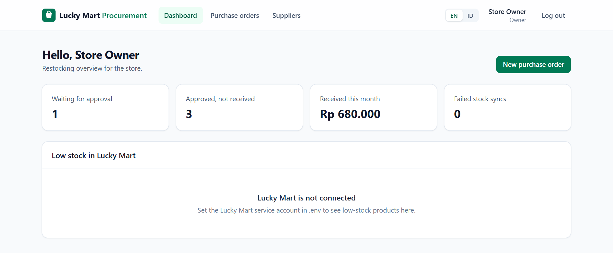 | 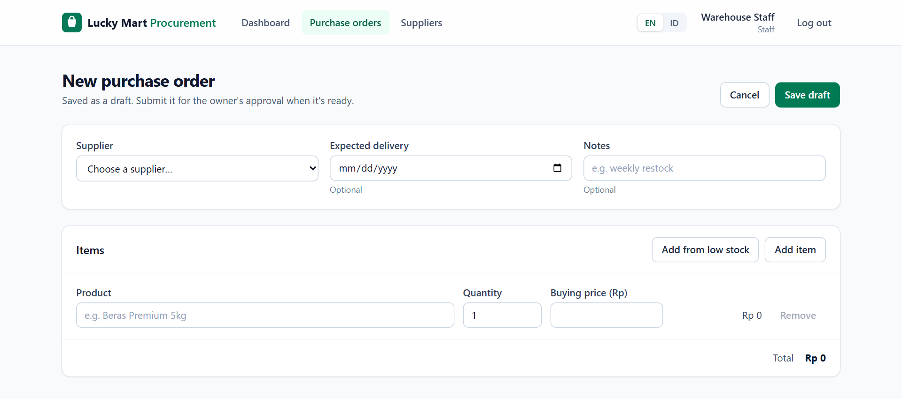 |
| **Dashboard** with what needs attention | **Staff** create an order, or add items from Lucky Mart's low-stock list |
| 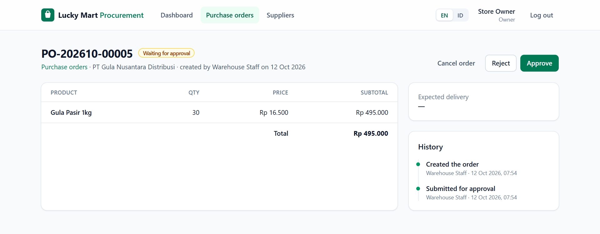 | 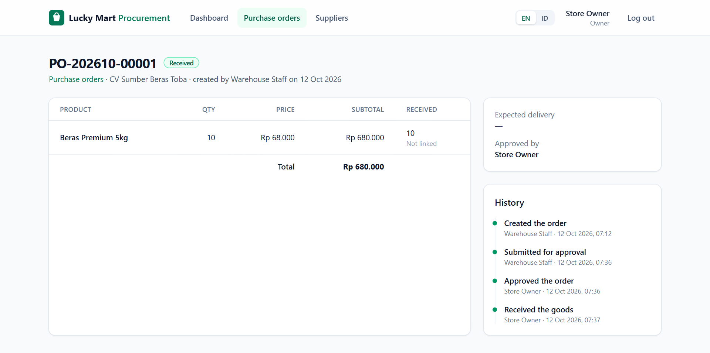 |
| **Owner** approves or rejects a submitted order | A received order with its history (audit trail) |
| 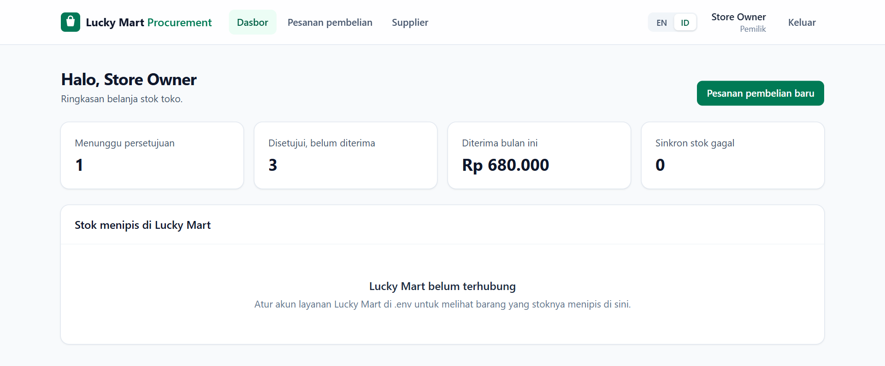 | 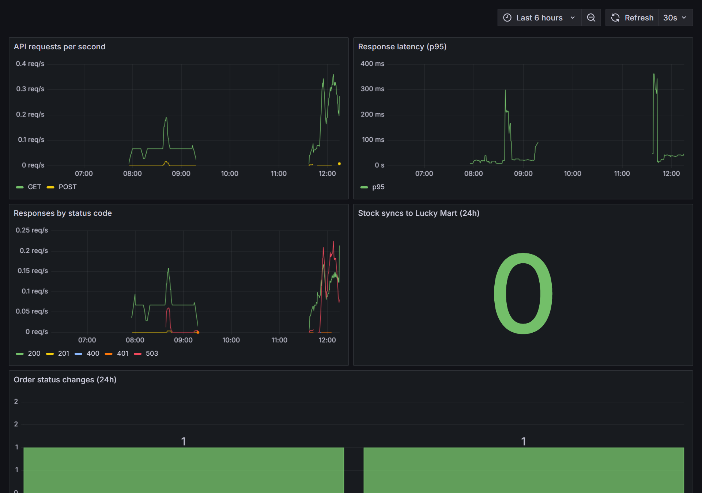 |
| The same dashboard in **Indonesian** | **Grafana**: request rate, p95 latency, status codes, order transitions |

## Architecture

Locally everything runs in Docker Compose. On AWS (CDK in [`infra/`](infra/README.md), not deployed)
the same containers run on ECS Fargate behind CloudFront.

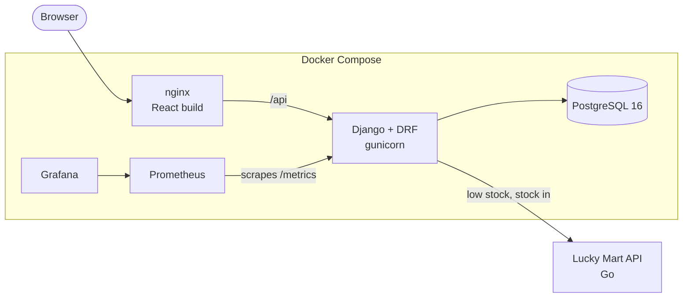

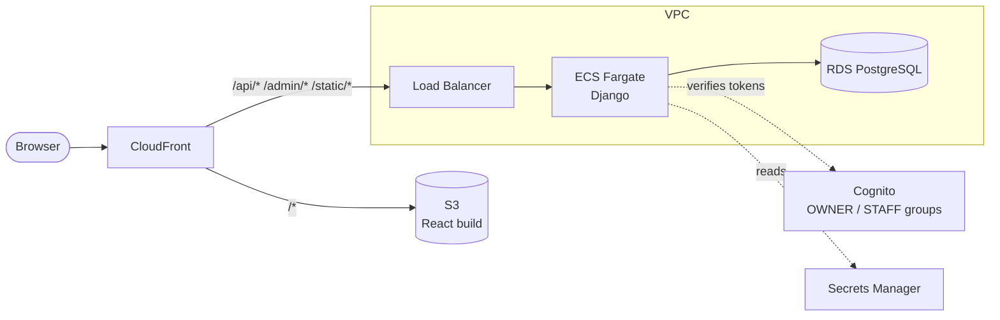

## Design decisions

| Decision | Why |
| --- | --- |
| Status changes live in one module (`procurement/workflow.py`), not in views | Every rule (who may approve, which status comes next) is in one place and tested directly |
| Row lock (`select_for_update`) on every status change | Two people clicking "approve" at the same time can't both succeed |
| Stock sync to Lucky Mart runs after the database transaction commits | A slow or failing Lucky Mart never rolls back a receipt; each line keeps its own sync status and can be retried |
| A line is never sent to Lucky Mart twice | A retry skips lines already marked `SYNCED`, so stock is not added twice |
| The creator of an order cannot approve it, even the owner | Simple segregation of duties, like in real procurement |
| Two authentication classes side by side (Cognito, then Simple JWT) | Local development needs no AWS account; on AWS the same API accepts Cognito access tokens |
| The frontend hides buttons the user can't use, but the API decides | `lib/orderActions.ts` mirrors the backend rules for a clean UI; the backend tests are the source of truth |

## Project layout

```
backend/     Django project: accounts (users, roles, Cognito), procurement (orders, workflow, Lucky Mart client)
frontend/    React + TypeScript app (pages, API hooks, EN/ID dictionaries)
infra/       AWS CDK stack (TypeScript) and its tests
monitoring/  Prometheus config and the Grafana dashboard
docs/        Screenshots
```

## Tech stack

| Part | Technology |
| --- | --- |
| Backend | Python 3.12, Django 5, Django REST Framework, Simple JWT, Amazon Cognito JWT verification |
| Database | PostgreSQL 16 |
| Monitoring | `/api/health/`, Prometheus metrics at `/metrics`, Grafana dashboard |
| Tests | pytest, pytest-django, responses · Vitest, Testing Library |
| Frontend | React 19 + TypeScript + Vite, TanStack Query, React Router, Tailwind CSS |
| CI | GitHub Actions: lint, tests, build, Docker images |
| Infrastructure | Docker Compose, nginx · AWS CDK: VPC, ECS Fargate, RDS, S3 + CloudFront, Cognito, Secrets Manager |

## Run locally

Requirements: Docker Desktop.

```bash
cp .env.example .env          # then set DEMO_PASSWORD
docker compose up -d
docker compose exec backend python manage.py seed_demo
```

Then start the frontend (Node.js 22+):

```bash
cd frontend
npm install
npm run dev
```

- App: http://localhost:5174 (users `owner` and `staff`, password from `DEMO_PASSWORD`)
- API health: http://localhost:8000/api/health/
- Django admin: http://localhost:8000/admin (user `owner`)

### Production-like stack and monitoring

```bash
docker compose --profile app --profile monitoring up -d --build
```

| Service | URL |
| --- | --- |
| App (React build served by nginx, proxying `/api`) | http://localhost:8081 |
| Prometheus | http://localhost:9090 |
| Grafana dashboard "Procurement Portal" | http://localhost:3030 |

The dashboard shows request rate, p95 latency, responses by status code, order status changes,
and stock syncs to Lucky Mart (`procurement_order_transitions_total`, `procurement_stock_sync_total`).

### Lucky Mart connection

To connect to Lucky Mart, run it on port 8080 and set `LUCKY_MART_PHONE_NUMBER` and
`LUCKY_MART_PASSWORD` in `.env` to a Lucky Mart user with a warehouse role.

## Tests

```bash
docker compose run --rm backend pytest
docker compose run --rm backend ruff check .

cd infra
npm run typecheck && npm test && npm run synth
cd ..

cd frontend
npm run typecheck && npm run lint && npm test
```

## API overview

| Method | Endpoint | Who |
| --- | --- | --- |
| POST | `/api/auth/login/` | everyone |
| GET | `/api/auth/me/` | signed in |
| POST | `/api/auth/change-password/` | signed in |
| GET/POST | `/api/suppliers/` | signed in |
| GET/POST | `/api/purchase-orders/` | signed in |
| POST | `/api/purchase-orders/{id}/submit/` | creator |
| POST | `/api/purchase-orders/{id}/approve/` · `reject/` | owner |
| POST | `/api/purchase-orders/{id}/receive/` · `sync-stock/` | signed in |
| GET | `/api/lucky-mart/low-stock/` | signed in |
| GET | `/api/dashboard/` | signed in |
